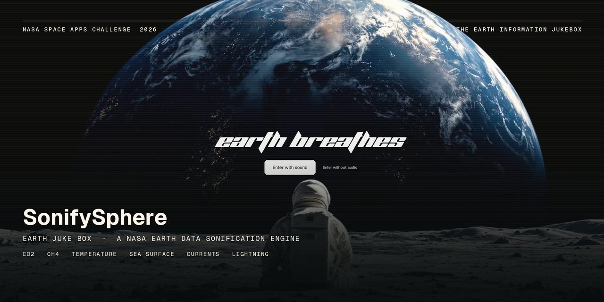

# SonifySphere

**Explore Earth through sight and sound.** SonifySphere is an interactive web platform and NASA Earth data sonification engine. It turns satellite imagery, scientific observations, and Earth Information Center visualizations into soundscapes and short listening games.

Built for [The Earth Information Jukebox, NASA Space Apps 2026](https://www.spaceappschallenge.org/2026/challenges/the-earth-information-jukebox/).

[Live site](https://www.sonifysphere.earth) · [Team page](https://www.spaceappschallenge.org/2026/find-a-team/sonifysphere/?tab=details) · [Challenge](https://www.spaceappschallenge.org/2026/challenges/the-earth-information-jukebox/) · [Source](https://github.com/acheronx0577/Earth-Juke-Box-Sonifysphere)

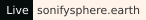 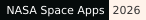 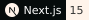 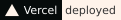 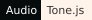

## What's new

The previous README stopped at the first Listen workspace, three challenge routes, and a security note. The live app has since shipped the following, all present on `main`:

- **Search and agents.** `sitemap.xml` with `lastModified`, `robots.txt`, canonical URLs, Open Graph and Twitter cards, JSON-LD, a Google Search Console verification file and meta tag, IndexNow, `/llms.txt`, and Markdown responses for the same URLs a browser loads as HTML. See [Performance and SEO](#performance-and-seo).
- **NASA Space Apps side badge.** A fixed cream tab on the right edge of every page except Listen. It links to the team page and the GitHub repository, waits until the home preloader is gone, and collapses to a meatball chip on a phone.
- **Listen.** A data switch for CO₂, CH₄, and temperature (`?data=co2|ch4|temp`), synth and orchestra voices, a continuous soundscape, and zoom proximity. Precipitation and elevation are extra layers. Classic Listen remains at `/listen/classic`.
- **Games.** Guess the Signal, Tune the Signal, and Waveform Ribbons, plus Compose. A shared chamfered share sheet copies a public URL. Guess can share the result that is on screen.
- **Site chrome.** Home preloader, Contact page, GitHub links in the navbar and footer, Vercel Web Analytics, and automatic lite mode when the device or connection is constrained.

## Scientific mapping

The About page states the schema in three voices (`src/components/about/VoiceTable.tsx`):

| Voice | Tracks | Sounds like |
|---|---|---|
| Pitch | CO₂ level, in ppm | A higher note as CO₂ rises |
| Pulse | The yearly swing | A steady beat, one swing per year |
| Click | Record months | A soft click at each new record |

Caldwell 73 (SVS 13786) is a conceptual credit only. It is not a key in `SVS_REGISTRY`, so the media proxy never fetches it. The credit line uses it as a mapping reference: luminosity toward volume, spatial position toward pitch.

Probe readings stay labeled **image-derived**. Empty samples are not reported as zero:

- The MERRA-2 air-temperature route parses the official GIBS colour-map XML. A `nodata` or transparent entry returns `null` (`valueForRgb` in `src/lib/nasa/gibsColormap.ts`). The page says the kelvin value is image-derived.
- Planetary Computer samples treat documented fill, nodata, `-999`, and non-finite values as `null` (`src/lib/listen/planetaryComputer.ts`).
- For a still that carries its own strip, `legendFromPixels` estimates an embedded colour bar. A dominant dark-grey cluster is labeled `NO DATA HERE` (`src/components/listen/v4/legend.ts`). The Listen stage then says “no data” or “not a measurement” instead of a fake instrument reading.

The Mauna Loa series on About is an embedded example, not a live feed. The chart marks 315.71 ppm in March 1958 and a 432.34 ppm record in May 2026.

## NASA Earth Information Center visual core

The Listen sources that are actually proxied are the four ids in `SVS_REGISTRY` (`src/lib/listen/svsMedia.ts`). SVS 5101 is also the Earth Information Center still served at `/api/listen/eic/image`.

| Asset | Title in the registry | What the server serves | Role in the sound |
|---|---|---|---|
| **SVS 5101** | Sea Surface Temperature (SST) — Near Real Time | Daily print still `sst_mur_most_recent_print.jpg` | Default EIC frame on `/listen`. The stage labels it image-derived. |
| **SVS 5196** | DYAMOND Global Carbon Dioxide | Print still and a 1080p MP4 | CO₂ frame. Meta line: `NASA SVS 5196 · image-derived`. |
| **SVS 3912** | Global Sea Surface Currents and Temperature | ECCO2 still `flat_global_ecco2_2028x1024` and `ecco2_sst_flow.mp4` | Currents frame. Meta line: image-derived. |
| **SVS 5011** | ISS lightning, 2017–2023 | Preview still and sphere MP4 | Pulse triggers. |
| **SVS 13786** | Caldwell 73 sonification | Not proxied | Conceptual credit on About only. |

Other providers wired in code: NASA GIBS (Blue Marble and the MERRA-2 colour map), NASA EPIC, NASA EONET, NASA POWER as the meteorological fallback, the NASA Image and Video Library, Microsoft Planetary Computer STAC sampling, Azure Blob container `satellite-cache` when configured, Meteomatics when credentials exist, Open-Meteo elevation with no API key, NOAA GML Mauna Loa as the embedded CO₂ example, and optional ElevenLabs textures that stay off unless the server flag is set.

## Data flow

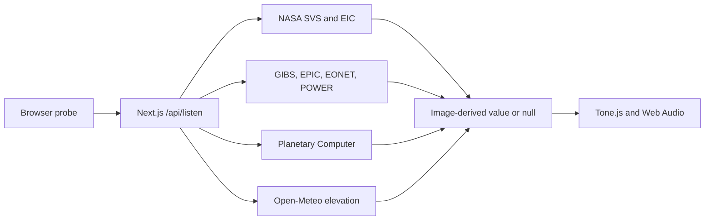

A browser on `/listen` never receives the upstream file URL. Allowlisted route handlers fetch the frame or the sample, attach an image-derived or no-data label, and the page plays the result with Tone.js. The same boxes are drawn in [`docs/readme/pipeline.svg`](docs/readme/pipeline.svg) for readers whose client does not render Mermaid.

The embedded Mauna Loa series does not travel this path. It ships with the page and is labeled as an example.

## Figures

Screenshots are 1440×900 except Fig. 9, which is a 390×844 phone.

**Fig. 1.** Home, after the preloader. The hero chip reads `AI-GENERATED IMAGE`. The NASA Space Apps badge is on the right edge, and the navbar includes GitHub.

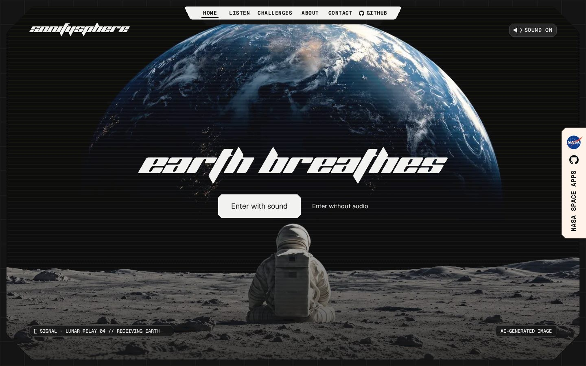

**Fig. 2.** Listen. Temperature is the selected layer. The sound profile offers synth or orchestra. Readings at the probe say image-derived or no data.

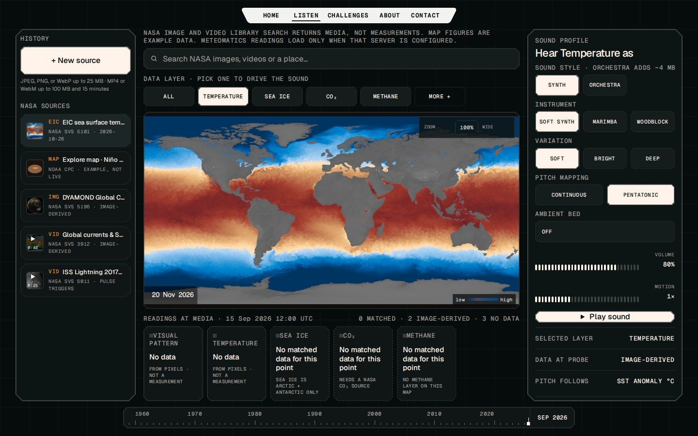

**Fig. 3.** Classic Listen at `/listen/classic`. Twelve regions, four seasons, and layer chips for temperature, sea ice, CO₂, and methane. The `data` query uses `co2`, `ch4`, or `temp`. Grey means no data for that layer.

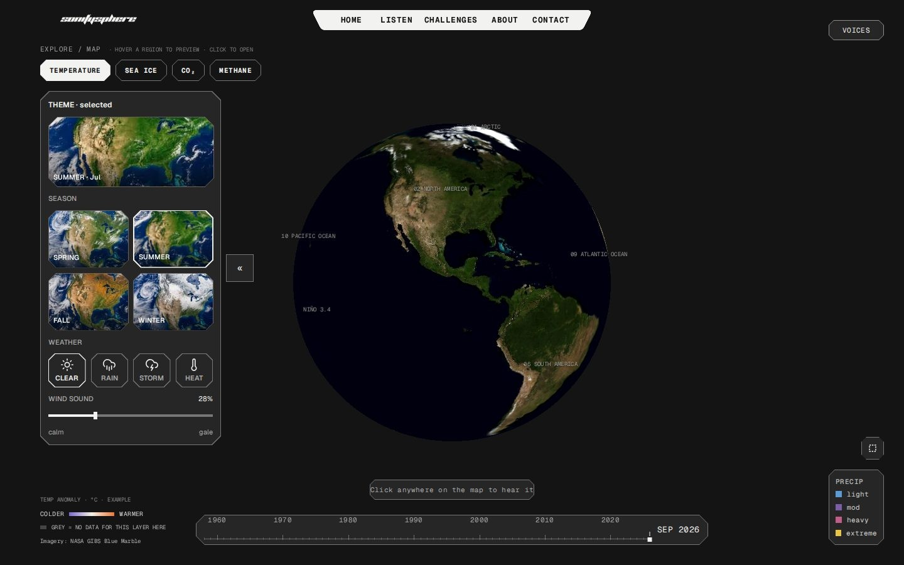

**Fig. 4.** About, *How it sounds*. The Mauna Loa callout is an embedded example: 315.71 ppm to 432.34 ppm.

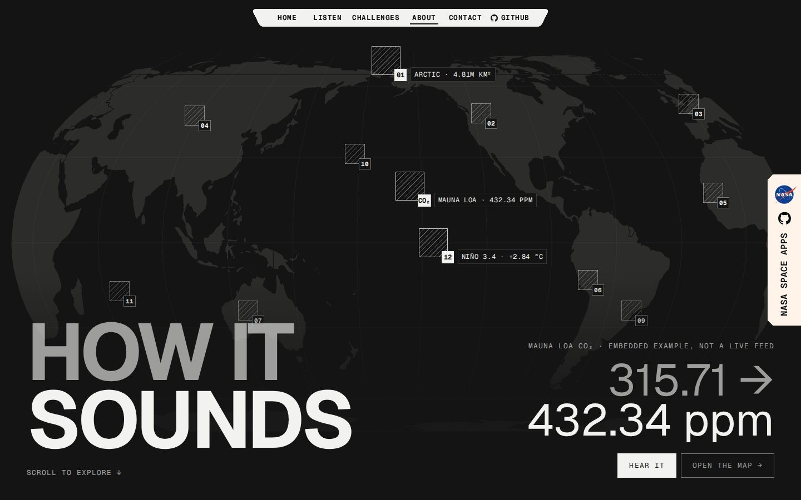

**Fig. 5.** Challenge hub. Three games: Guess the Signal, Tune the Signal, Waveform Ribbons.

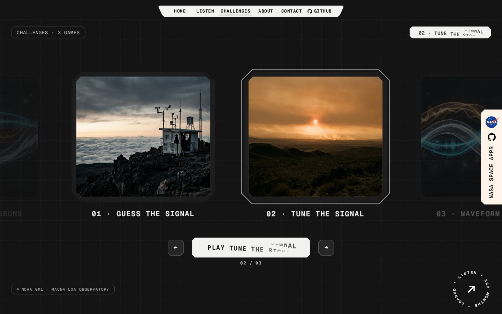

**Fig. 6.** Guess the Signal. The round plots its own series. Clue chips name the layer, season, and weather.

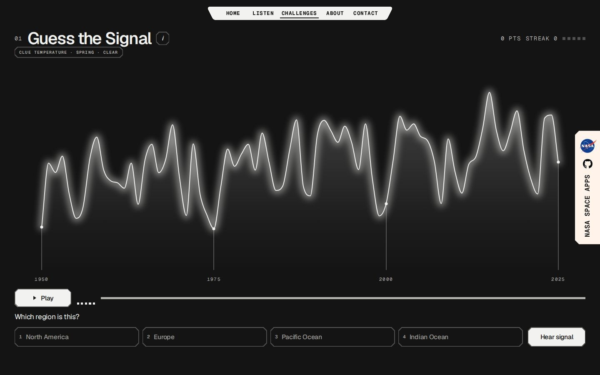

**Fig. 7.** Tune the Signal, Challenge 02. Frequency and resonance (Q) are matched to a target phrase. Round 1 is the 1958 Keeling baseline, 315.71 ppm.

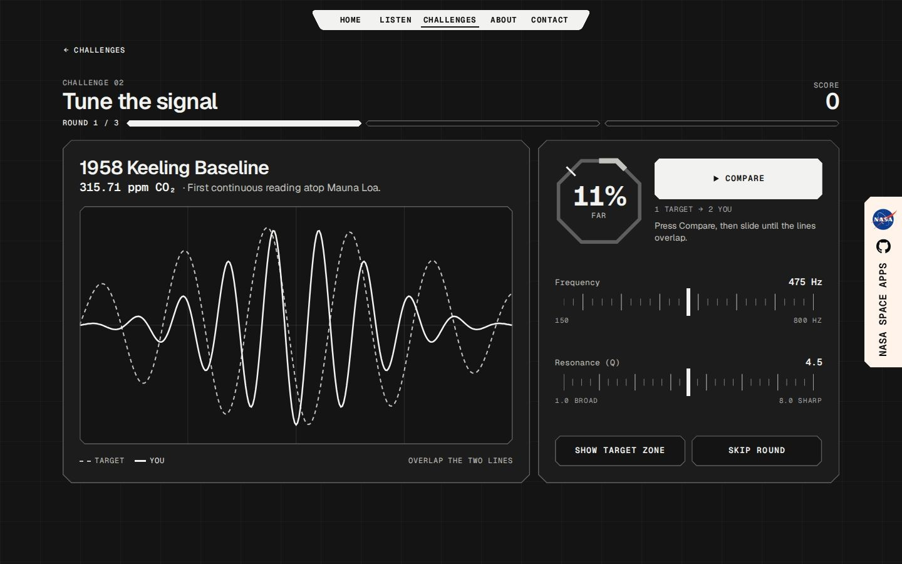

**Fig. 8.** Compose. Regions and records drag into eight slots. The mix can be played or shared.

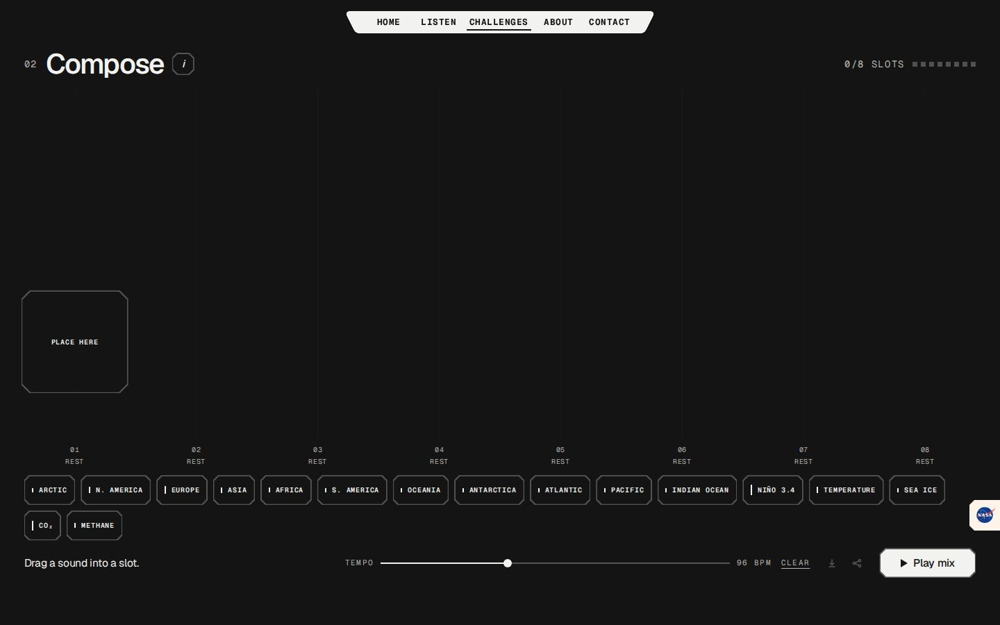

**Fig. 9.** Home at phone width. The Space Apps control is a meatball chip. The preloader has cleared.

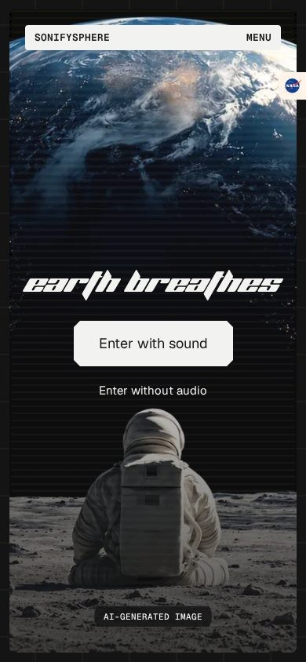

## Games

| Route | Game | What you do |
|---|---|---|
| `/challenge` | Hub | Three story games. `/play` and `/challenges` redirect here. |
| `/challenge/guess` | Guess the Signal | Hear a phrase and name the region or the record. A shared round uses `seed`. A shared scorecard uses `result`. |
| `/challenge/match` | Tune the Signal | Overlap your tone with a Keeling phrase. Sliders are frequency and resonance (Q). |
| `/challenge/ribbons` | Waveform Ribbons | Follow a seasonal curve by ear. `/challenge/ribbon` redirects here. |
| `/challenge/compose` | Compose | Drag regions and records into a short mixtape. `mix` reopens a shared arrangement. |

Share sheets (`src/components/play/ShareSheet.tsx`) use one chamfered layout: a URL field, a copy icon, and paired actions. Classic Listen has its own sheet (`ShareListenModal`) and writes `data=co2|ch4|temp` into the link.

## Performance and SEO

Lighthouse **13.6.0** against [https://www.sonifysphere.earth/](https://www.sonifysphere.earth/), one lab run on **22 November 2026** (Chrome 157 headless). These numbers are not stored in an earlier pull request. A single lab run moves with the network and with main-thread work on the home globe.

| Form factor | Performance | Accessibility | Best practices | SEO | Fetched (UTC) |
|---|---:|---:|---:|---:|---|
| Mobile | 85 | 100 | 100 | 100 | 2026-11-22T11:47:20Z |
| Desktop | 99 | 100 | 100 | 100 | 2026-11-22T11:47:34Z |

Mobile used Lighthouse’s default phone emulation. Desktop used `--preset=desktop` (1350×940). These are lab scores from one run each, not Chrome User Experience Report field data.

| Vital | Mobile | Desktop |
|---|---:|---:|
| First contentful paint | 1.2 s | 0.3 s |
| Largest contentful paint | 3.9 s | 0.8 s |
| Total blocking time | 90 ms | 0 ms |
| Cumulative layout shift | 0 | 0 |
| Speed index | 4.3 s | 1.3 s |
| Time to interactive | 3.9 s | 0.8 s |

What the code does for that result:

- Hero images set `fetchPriority="high"` (`src/components/landing/HeroSection.tsx`).
- Fonts, `/assets`, `/audio`, team portraits, and About media use `Cache-Control: public, max-age=31536000, stale-while-revalidate=86400` (`src/lib/staticCache.ts`).
- `npm run lighthouse` runs the same CLI locally. It is a devDependency, not a hosted score archive.
- Automatic lite mode (`src/lib/liteMode.ts`) turns extra rendering down on Save-Data, a slow connection, or a device with very little memory or few cores. A previously stored `sonifysphere-lite` choice still wins.
- Vercel Web Analytics is mounted from the root layout.

Indexing, verified in `src/app/layout.tsx`, `src/app/sitemap.ts`, `src/app/robots.txt/route.ts`, and `src/lib/agentCopy.ts`:

- `metadataBase` is `NEXT_PUBLIC_SITE_URL` or `https://www.sonifysphere.earth`. Each page sets `alternates.canonical` to `./`.
- Open Graph and Twitter use a 1200×630 share image at `/og-image.png`.
- Homepage JSON-LD is `WebSite`, `WebApplication` (free educational app), and `Organization`. `SiteNavigationElement` lists the main pages. About, Listen, Challenge, Story, Contact, and Privacy add `BreadcrumbList`.
- The first icon is `/favicon-48x48.png`, with `/favicon.ico` as the shortcut icon.
- Google Search Console is verified with a meta tag and `public/googled20aa7835b26dc03.html`.
- IndexNow posts the public URL list to `api.indexnow.org`. The key file lives in `public/`, and `npm run indexnow` sends the ping.
- `robots.txt` allows `/` and points at the sitemap and `/llms.txt`.
- `/`, `/about`, `/listen`, `/challenge`, and `/contact` answer `Accept: text/markdown` with Markdown and `Vary: Accept`. A missing URL stays HTTP 404.

## Stack


Versions below are the installed lockfile versions on `main`.

| Layer | Technology |
|---|---|
| Framework | Next.js 15.5.28, App Router, Node.js route handlers |
| UI | React 19.3.1, TypeScript 5.9.3, Tailwind CSS 4.1.4 |
| Type | Geist, Geist Mono, Planet Kosmos |
| Motion | GSAP 3.13, Motion 14.14, Lenis 1.3 |
| Audio | Tone.js 15.1.22 and the Web Audio API. Synth or orchestra samples. |
| Map and raster | MapLibre GL 5.24, WebGL, Zarrita, pngjs |
| 3D | Three.js on the contact deck |
| Jobs | Azure Blob `satellite-cache` when configured, in-process satellite jobs, Microsoft Planetary Computer, Open-Meteo elevation |
| Measure | Playwright, Node test runner, ESLint 10, Lighthouse 13.6 |

## Quick start

```sh
git clone https://github.com/acheronx0577/Earth-Juke-Box-Sonifysphere.git
cd Earth-Juke-Box-Sonifysphere
npm ci
npm run dev
```

Node.js 20 or newer. Open [http://localhost:3000](http://localhost:3000). The interface runs without provider keys. NASA Open APIs fall back to `DEMO_KEY`. Meteomatics, Azure, Planetary Computer, and ElevenLabs stay quiet until their variables are set.

<details>
<summary>Environment variables</summary>

Optional `.env.local` values. Nothing in this list is hardcoded.

| Variable | Role |
|---|---|
| `NASA_API_KEY` | NASA Open APIs. Unset or unusable values use `DEMO_KEY`. |
| `AZURE_STORAGE_CONNECTION_STRING` | Durable satellite-scene cache. |
| `AZURE_STORAGE_CONTAINER_SAS_URL` | Alternate Azure auth. `AZURE_BLOB_SAS_URL` is accepted too. |
| `PLANETARY_COMPUTER_API_KEY` | Planetary Computer. `PC_SDK_KEY` and `AZURE_PLANETARY_COMPUTER_KEY` are aliases. |
| `METEOMATICS_USERNAME` / `METEOMATICS_PASSWORD` | Point weather. Missing credentials fall through to NASA POWER. |
| `ELEVENLABS_API_KEY` | Optional textures. |
| `ELEVENLABS_SOUND_GENERATION_ENABLED` | Must be `true` or the route returns 503. |
| `NEXT_PUBLIC_SITE_URL` | Canonical origin. Defaults to `https://www.sonifysphere.earth`. |

</details>

<details>
<summary>Tests</summary>

```sh
npm run typecheck
npm run lint
npm run test:unit
npm run test:planetary-computer
npm run test:satellite-jobs
npm run test:svs
npm run test:eic
npm run build
npm run test:e2e
npm run lighthouse -- https://www.sonifysphere.earth
```

`test:unit` covers Listen audio mapping, proximity, elevation, IndexNow, lite mode, and the agent Markdown contract. `test:e2e` is Playwright, including axe checks on Listen.

</details>

<details>
<summary>Security</summary>

- Secrets come from the environment. A missing Meteomatics or ElevenLabs configuration fails closed. NASA's own `DEMO_KEY` is the documented fallback for `NASA_API_KEY` only.
- NASA image bytes are fetched only from `https://images-assets.nasa.gov`. SVS media must be `https://svs.gsfc.nasa.gov/vis/…` and an id in `SVS_REGISTRY`. GIBS tiles must be `https://gibs.earthdata.nasa.gov`.
- `isSafeNasaId` rejects `..`, path separators, and control characters.
- `/api/listen/measurements` and `/api/listen/sound-variation` use a sliding window and answer HTTP 429 with `Retry-After`.
- Satellite scenes use an in-memory `MeasurementCache`, then Azure Blob container `satellite-cache` when credentials exist, then HTTP `Cache-Control`.
- Every response sets `X-Frame-Options: SAMEORIGIN`, `X-Content-Type-Options: nosniff`, `Referrer-Policy: strict-origin-when-cross-origin`, and `Permissions-Policy: camera=(), microphone=(), geolocation=()`.
- Anonymous satellite jobs carry a server-issued `guestSessionId` (`src/lib/listen/satelliteJobs.ts`).

</details>

## Team and credits

Names and roles are the About team in `src/data/aboutData.ts`.

- **Richard Huynh** — Team Leader
- **Erin Sur** — Visual and UI Design
- **Quoc Pham** — Audio Architect
- **Ryan Wang** — Frontend Engineer
- **Aqila Nasiry** — Atmospheric Research
- **Irmuun Temuulel** — Systems Engineer

Team page: [sonifysphere on NASA Space Apps 2026](https://www.spaceappschallenge.org/2026/find-a-team/sonifysphere/?tab=details). Inquiries go through [Contact](https://www.sonifysphere.earth/contact).

**Credits and disclosures.**

- Scientific figures come from NASA, NOAA, and Microsoft Planetary Computer endpoints, or from series embedded in the page and labeled as examples.
- Listen audio is synthesized in the browser with Tone.js and the Web Audio API. Downloaded mixes from `src/lib/signalPlayback.ts` write RIFF `INFO` tags. They are not the output of an AI audio model.
- The home hero is marked `data-si-tool="ChatGPT"` and the visible chip reads `AI-GENERATED IMAGE`. Irmuun Temuulel's About portrait and contact card are labeled `AI-GENERATED IMAGE`.
- Optional ElevenLabs loops exist only when the server flag is on, and the product copy tags them as AI-generated.
- Footer credit for the tools used on the project: Grok Bot, ChatGPT, Claude, Antigravity, and Codex.
- Orbit Matter layout by [Codegrid](https://www.youtube.com/@codegrid). FlowingMenu adapted from [React Bits](https://reactbits.dev/). Planet Kosmos by Mads Rydahl. Geist and Geist Mono by Vercel.
